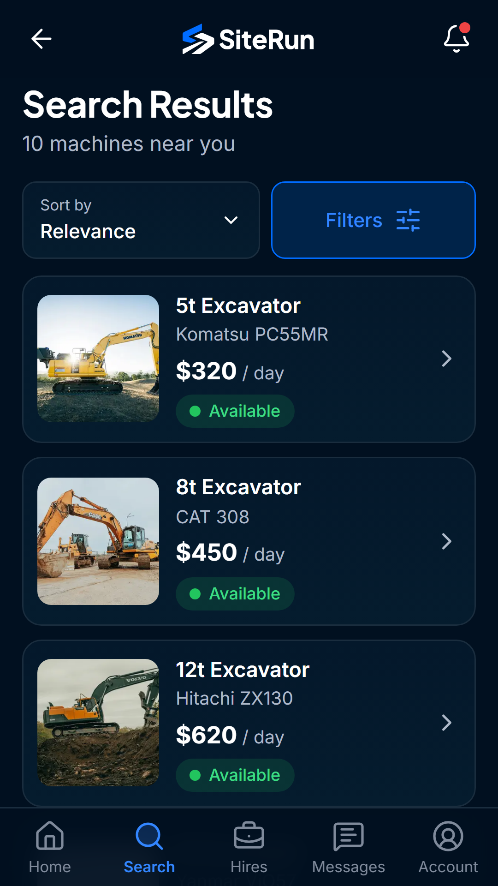
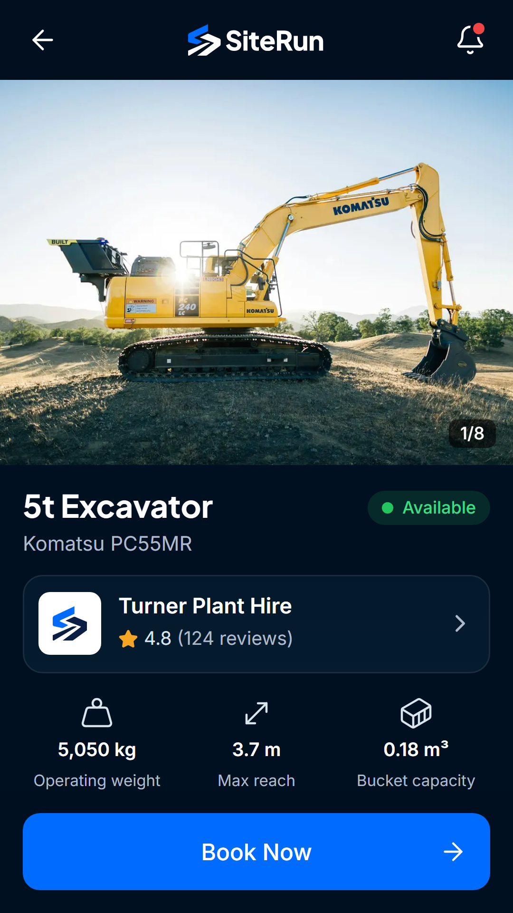

# SiteRun

**Construction equipment hire marketplace for Australia.** SiteRun connects contractors who need machines with the suppliers who hire them out, plus an admin console for the platform team.

_Machines. People. Progress._

## What it does

- **Contractors:** search and filter machines on a map, book a hire, pay by card, extend a hire, and message the supplier in real time.
- **Suppliers:** list machines, upload compliance documents, accept bookings, see payouts, and track machines on hire with live GPS.
- **Admins:** approve suppliers and machines, review compliance, and manage the marketplace.
- **Everywhere:** responsive web app, installable PWA with offline support, and native Android and iOS apps.

## Tech stack

| Area | Tools |
| --- | --- |
| Front end | React 18, TypeScript (strict), Vite, React Router, Tailwind CSS 4, TanStack Query, react-hook-form + zod, framer-motion |
| Back end | Supabase: Postgres with Row Level Security, Auth, Storage, Realtime, pg_cron |
| Payments and maps | Stripe card payments, Leaflet maps, live GPS tracking |
| Mobile | Capacitor (Android and iOS), push notifications |
| Quality | Vitest unit tests, Row Level Security tests, Playwright end-to-end flow tests |
| Hosting | Vercel |

## Highlights

- End-to-end tests cover the full booking loop: search, book, supplier accepts, confirmation, extend hire and real-time messaging.
- Security hardening pass with database-level access rules tested against seeded accounts.
- Store submission prepared for Google Play and the App Store.

## Source code

The source code is kept in a private repository. I'm happy to walk through it in an interview.

**Built by Omar Al Azhari** · [LinkedIn](https://www.linkedin.com/in/omar-alazhari-028a6a203)
