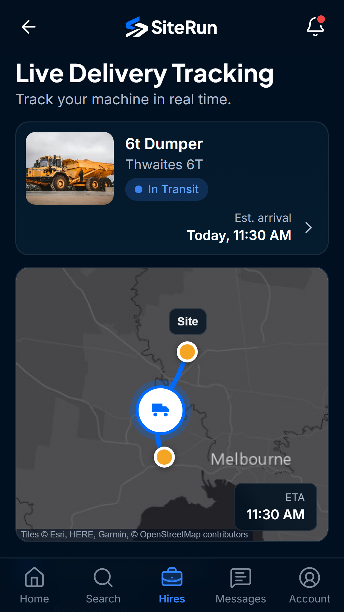
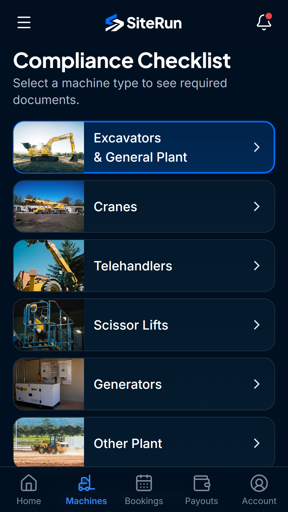

# SiteRun

**A construction equipment hire marketplace for Australia, with a web app plus Android and iOS apps.** Contractors find and book machines, suppliers list and track them, and platform admins keep the marketplace safe.
_Machines. People. Progress._

**Designed and built by Omar Al Azhari.** No public deployment yet; run it locally in a few minutes with the offline demo backend (see [Setup](#setup)).

<p>




</p>

## Key features

- **Contractors:** map search and filters, booking, card payments, hire extensions, reviews, and real-time chat with the supplier.
- **Suppliers:** machine listings with photos, compliance documents with expiry warnings, booking approvals, payouts, and live GPS tracking of deliveries.
- **Platform admins:** approve suppliers and machines, review documents, cancel or adjust bookings with a written reason, and view error reports and usage analytics.
- **Everywhere:** responsive web app, installable PWA with offline support, and native Android and iOS apps through Capacitor.

## How it was built

I built SiteRun end to end: the product idea, the specification, the design, the architecture and every technical decision (recorded in `DECISIONS.md`), through to the web app, the mobile apps and the test suites. I used an AI coding assistant (Claude Code) as a tool to write code faster, which is why commits are co-authored. I directed every phase and reviewed and tested every change before it was committed.

## Challenges solved

- **The database is the security boundary.** Every table has Row Level Security, and every action with business rules (bookings, approvals, payouts) is a `SECURITY DEFINER` function that checks the caller first, so a modified client can't skip a rule. `npm run test:rls` signs in as each seeded role to prove it.
- **One app, two backends.** The same API interface runs on Supabase or on an in-browser demo store with the same data and rules, so every screen works offline and the UI tests don't need a database.
- **Payments without storing cards.** Stripe handles card entry, charges and supplier payouts through Connect; the database keeps only brand, last four digits and expiry.
- **Testing whole journeys, not just functions.** Playwright walks the full loop (search, book, supplier accepts, confirmation, extend the hire, real-time messages) against a real Supabase project.

## How it's tested

| Command | What it checks |
| --- | --- |
| `npm test` | Vitest unit tests for the pure logic (booking maths, money, ABN checks, cards), offline |
| `npm run test:rls` | Row Level Security against a Supabase project, signed in as each seeded role |
| `npm run e2e` | Playwright on the demo backend: component gallery, every screen against the design boards, sign-up to first site |
| `npm run e2e:flows` | Playwright against Supabase: booking, extensions, messaging, supplier onboarding and admin approval |

## Stack

Vite + React 18 + TypeScript (strict), React Router 6, Tailwind CSS 4, lucide-react, framer-motion, react-hook-form + zod, TanStack Query, Supabase (Postgres, Auth, Storage, Realtime, pg_cron), Leaflet, Recharts, date-fns, @react-pdf/renderer. Tests use Vitest and Playwright. Hosting is set up for Vercel. Capacitor builds the Android and iOS apps.

## Setup

```bash
npm install
cp .env.example .env    # fill in the Supabase URL and anon/publishable key
npx playwright install chromium
npm run dev             # http://localhost:5173
```

Without Supabase values in `.env` the app runs on an in-browser demo store with the same data and rules, so every screen works offline.

## Scripts

| Script                  | What it does                                                                                                                                                                                                                           |
| ----------------------- | -------------------------------------------------------------------------------------------------------------------------------------------------------------------------------------------------------------------------------------- |
| `npm run dev`           | Start the dev server on port 5173                                                                                                                                                                                                      |
| `npm run build`         | Type-check and build for production                                                                                                                                                                                                    |
| `npm run typecheck`     | TypeScript only                                                                                                                                                                                                                        |
| `npm run lint`          | ESLint                                                                                                                                                                                                                                 |
| `npm run format`        | Prettier                                                                                                                                                                                                                               |
| `npm test`              | Vitest unit tests (offline)                                                                                                                                                                                                            |
| `npm run test:rls`      | Row Level Security tests against the Supabase project in `.env`, signed in as the seeded accounts                                                                                                                                      |
| `npm run e2e`           | Playwright: component gallery, every screen against the design boards, and sign-up → verify → business profile → first site. Runs on the demo backend (port 5174)                                                                      |
| `npm run e2e:flows`     | Playwright against Supabase (port 5175): search → book → supplier accepts → confirmation; extend hire; realtime messaging; supplier lists a machine → uploads documents → admin approves → machine appears in search; admin area guard |
| `npm run og:image`      | Regenerate `public/og-image.png`                                                                                                                                                                                                       |
| `npm run native:assets` | Regenerate app icons and splash screens for Android and iOS (fetches `@capacitor/assets` with `npx`)                                                                                                                                   |
| `npx cap sync`          | Copy the built web app into the Android and iOS projects                                                                                                                                                                               |
| `npm run store:shots`   | Regenerate the store screenshots into `docs/store/`                                                                                                                                                                                    |
| `npm run store:assets`  | Regenerate the Play feature graphic and the store icons                                                                                                                                                                                |
| `npm run db:seed:sql`   | Regenerate `supabase/seed.sql` from the demo seed                                                                                                                                                                                      |
| `npm run brand:assets`  | Regenerate logos, favicons and icons from the traced mark                                                                                                                                                                              |

## Environment variables

| Variable                      | Description                                                                                                  |
| ----------------------------- | ------------------------------------------------------------------------------------------------------------ |
| `VITE_SUPABASE_URL`           | Supabase project URL                                                                                         |
| `VITE_SUPABASE_ANON_KEY`      | Supabase anon or publishable key (public). Never the service role key                                        |
| `VITE_SHOW_DEMO_LOGINS`       | `true` lists the seeded demo logins on the login screen. Leave empty in production                           |
| `VITE_BACKEND`                | `demo` forces the in-browser demo backend even when Supabase values are set                                  |
| `VITE_SITE_URL`               | Public site URL (no trailing slash) for canonical and social preview tags                                    |
| `VITE_PUSH_ENABLED`           | `true` turns on push registration in the apps (needs Firebase and APNs first)                                |
| `VITE_STRIPE_PUBLISHABLE_KEY` | Stripe publishable key. With it set, cards are entered in Stripe's fields and charged for real (`LAUNCH.md`) |

Every `VITE_` variable is compiled into the JavaScript bundle, so only public values may
use that prefix. The service role key is never one of them — it belongs in the Supabase
dashboard. Never commit `.env`.

## Supabase

Migrations live in `supabase/migrations` (schema, RLS, business functions, storage/realtime/cron, hardening, rate limits). Apply them in order with the Supabase CLI (`supabase db push`) or the SQL editor, then load the demo data:

```bash
npm run db:seed:sql     # writes supabase/seed.sql (dates relative to when it runs)
psql "$DATABASE_URL" -f supabase/seed.sql
```

`seed.sql` **wipes all app data and every `*.test` user** before loading, so only run it on a demo project.

How it fits together:

- Every table has RLS. Reads go through tables and `security_invoker` views (`machine_details`, `booking_details`, `conversation_list`), so the caller's policies apply.
- Anything with business rules (bookings, extensions, reviews, approvals, payouts, plans) is a `SECURITY DEFINER` function that checks the caller first. Triggers stop clients changing listing status, document review fields or profile flags directly.
- Platform admin is `profiles.is_platform_admin`, set in the database only. Sign-up metadata can never set it.
- Payments are mocked. Only card brand, last four digits and expiry are stored (`payment_methods.last4` is `char(4)`).
- Storage buckets: `machine-photos` (public), `avatars` (public), `compliance-docs` and `message-attachments` (private, signed URLs).
- Realtime: messages, notifications, deliveries and bookings.
- Edge Functions (`supabase/functions`): `payments` (Stripe cards, charges, supplier payouts through Connect, refunds), `stripe-webhook` (Stripe events, signature-checked), `push` (Firebase and Apple push) and `email` (Resend). The last two are called only by the database. Their secrets are set in Supabase, never in `.env`; see `LAUNCH.md`.
- Live GPS: drivers share position through `report_location()` while a delivery is in transit; the simulator only moves deliveries without real GPS.
- Error reports: `log_client_error()` from the website and apps, listed for admins at `/admin/errors`, kept 90 days.
- Usage counts: `track_event()` records searches, machine views and bookings for the admin analytics screen at `/admin/analytics`, kept 180 days.
- Platform admin tools: `admin_cancel_booking()`, `admin_adjust_booking()` and refunds, each with a written reason, a notification to both organisations and an entry in the activity feed.
- pg_cron: `siterun-document-expiry` (daily 20:00 UTC, 06:00 AEST) warns at 30/14/7 days and pauses listings with expired required documents; `siterun-simulate-deliveries` moves in-transit trucks along their route every 20 seconds.

### Auth settings (Supabase dashboard)

1. **Email OTP.** Authentication → Emails → _Confirm signup_: include `{{ .Token }}` so users get the 6-digit code the Verify screen asks for, for example `Your SiteRun code is {{ .Token }}`. The link in the same email also works.
2. **SMTP.** The built-in sender only mails project members and is rate limited. Add your own SMTP provider before inviting real users.
3. **URL configuration.** Set the Site URL to the deployed domain and add `http://localhost:5173/**` to the redirect URLs (used by email links, password reset and OAuth).
4. **Google / Apple.** Authentication → Providers: add the client ID and secret for each. The buttons on the login screen work once a provider is enabled.

## Security

`SECURITY.md` has the full picture: RLS on every table, caller checks in every
`SECURITY DEFINER` function, per-user rate limits, the response headers in `vercel.json`,
and the two dashboard settings only the project owner can turn on. In short: the database
is the boundary, the publishable key is public on purpose, and the app never stores a
password or a card number.

## Deploy (Vercel)

`vercel.json` holds the build and routing settings. `npm run build` also prerenders the landing page into `dist/index.html` and writes `dist/app.html` for every other route.

1. Push the repo to GitHub and import it in Vercel, or run `npx vercel login` then `npx vercel --prod` from this folder.
2. Set these environment variables in the Vercel project: `VITE_SUPABASE_URL`, `VITE_SUPABASE_ANON_KEY`, `VITE_SITE_URL` (the production URL, used in canonical and social tags) and, for a demo deployment, `VITE_SHOW_DEMO_LOGINS=true`.
3. In Supabase → Authentication → URL configuration, set the Site URL to the Vercel domain and add it to the redirect URLs.

## Project layout

```
design/            Source-of-truth design boards (00-brand … 10-supplier-admin)
public/            Favicons, PWA icons, web manifest, brand SVGs, photos (public/images)
scripts/           Brand assets, photo fetch, board comparison, seed SQL generator
supabase/          Migrations, seed, RLS tests
src/components/    ui (design system), layout, navigation, domain, brand
src/data/          Api interface, React Query hooks, demo backend, Supabase backend
src/pages/         Screens by area (auth, browse, bookings, hires, supplier, admin, operator …)
src/lib/           Pure logic (ABN, money, booking maths, cards, PDFs)
e2e/               Playwright on the demo backend
e2e-flows/         Playwright on Supabase
e2e-audit/         Full-site audit: pages, features, visuals, native shell
android/, ios/     Capacitor app projects (see MOBILE_BUILD.md)
src/native/        Platform checks, device features, native bootstrap
docs/checkpoints/  Checkpoint screenshots and board comparisons
```

## Dev pages

Only in `npm run dev`: the `/dev/*` route is compiled out of production builds.

- `/dev/brand`: logos, colour tokens and type samples
- `/dev/components`: every UI component in every state
- `/dev/screens`: every screen, grouped by board, with a role switcher (demo backend only)

## Demo logins

These accounts exist in the offline demo backend, and `supabase/seed.sql` creates them in a Supabase project. Only load the seed into a demo project, never one with real users. All accounts use the password `SiteRun!2026`; in demo mode the verification code is `123456`.

| Role                               | Email                     | Organisation              |
| ---------------------------------- | ------------------------- | ------------------------- |
| Contractor                         | alex@acme.test            | Acme Construction Pty Ltd |
| Supplier                           | jordan@turnerplant.test   | Turner Plant Hire         |
| Operator                           | sam@turnerplant.test      | Turner Plant Hire         |
| Organisation admin                 | priya@buildco.test        | BuildCo Pty Ltd           |
| Platform admin                     | admin@siterun.test        | SiteRun                   |
| New user (no business profile yet) | jamie.carter@buildco.test | —                         |
